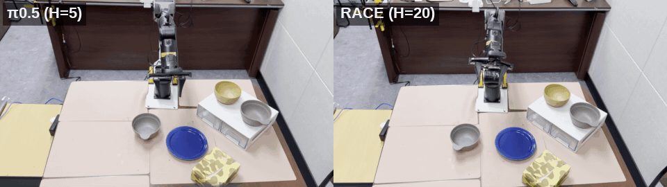

# When to Switch: Reliable Action-Chunk Extension for Vision-Language-Action Models

Official repository for **RACE** (**R**eliable **A**ction-**C**hunk **E**xtension).
Code will be released soon.

## Demo

  
   
  <em>A real-robot pick-and-place episode (1× speed). Left: π0.5 replanning every 5 actions.
  Right: RACE replanning every 20 actions (4× longer chunks).
  Both policies use asynchronous execution with
  <a href="https://arxiv.org/abs/2506.07339">real-time chunking</a>,
  which generates the next chunk while the current one is executed.</em>

## Abstract

Vision-Language-Action (VLA) models serve as unified policies for robotic manipulation,
yet their expensive inference forces robots to pause between policy calls,
resulting in stop-and-go execution that interrupts smooth motion and prolongs task completion.
Extending the action chunk reduces policy calls and hence these pauses,
but predicting farther into the future makes long-chunk execution unreliable.
To understand where this unreliability arises,
we analyze action errors within long chunks and find that they concentrate around transitions
between manipulation subskills, growing sharply with chunk length.
This suggests the importance of *transition timing*, i.e., when to switch subskills within a chunk.
Motivated by this observation, we introduce RACE (Reliable Action-Chunk Extension),
a framework that predicts the transition timing from an auxiliary one-step denoising pass
and conditions action generation on it.
By learning and conditioning on transition timing,
RACE reduces errors at subskill transitions and enables reliable execution of longer action chunks.
Across simulation benchmarks, RACE outperforms fine-tuning at the same chunk length;
with 2× longer chunks, it surpasses recent state-of-the-art and efficient VLAs in success rate,
and with 4× longer chunks, it remains competitive.
On a real robot, RACE uses 4× longer chunks,
which reduces the idle time caused by stop-and-go execution by about 5×,
while achieving a higher success rate than fine-tuning with the same chunk length.
